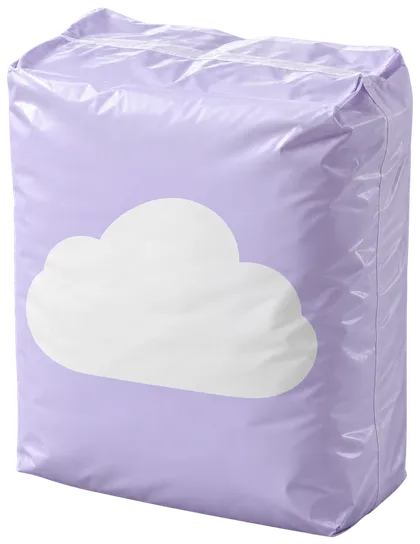

# Charity Campaign Template

A one-page appeal where visitors give by packing a crate. The worked example is **Hollins Lane Larder**, a community food bank in the old Co-op on Hollins Lane, Walkley, Sheffield, raising £38,000 to keep its shelves full until spring.

The first screen does what strong charity sites do: a full-bleed photograph, a headline as big as the window allows, a give card whose amounts say what they buy, and a raised-so-far strip along the bottom. Further down, nine items sit on a wooden shelf with their prices. Drag one into the crate, tap it or press Enter, and the total, the sentence describing what the crate does and the donation form amount all update together.

Static files, no build step, no backend.

---

## Quick Start

1. Upload the folder to any static host, or open `index.html` in a browser.
2. Edit the appeal copy and figures in `index.html`: the headline, the raised-so-far strip, the stats and the stories are plain markup.
3. Replace the shelf items with what your appeal buys (see **Pack a crate**).
4. Replace the photographs in `assets/img/` (see **Images**).
5. Point the donation form at your donation platform (see **The donation form**).

## Using It With Your Own Design

Every section is a self-contained block in `index.html`, and every initialiser in `assets/script.js` returns early when its markup is missing. Delete the stories, the trust card, the shifts or the Buy it all band and the rest keeps working.

Behaviour hooks are `data-` attributes (`data-crate`, `data-item`, `data-give-form`, `data-give-card`, `data-amount-input`, `data-outcome` and so on); class names are for styling only. To restyle, repaint the colour tokens at the top of `assets/style.css`, then adjust section rules. Type is Smooch Sans (display and figures, weights 800 and 900) and Be Vietnam Pro (body, 400, 600 and 700), self-hosted in `assets/fonts/` (see **Fonts**).

## Files

| File | What it is |
|---|---|
| `index.html` | The appeal page |
| `thanks.html` | The thank-you page the form submits to |
| `assets/style.css` | Tokens, layout, section styles, reveal gates and reduced-motion overrides |
| `assets/script.js` | Readable source |
| `assets/script.min.js` | Minified copy of the same script; point the `<script>` tags at it in production if you like |
| `assets/favicon.svg` | The crate mark |
| `assets/fonts/` | Self-hosted Smooch Sans and Be Vietnam Pro (Latin woff2) and their licence, `OFL.txt` |
| `assets/img/` | Bundled WebP images |
| `assets/img-src/` | Transparent masters for the crate and the nine item cut-outs |
| `assets/img-manifest.json` | Sources, crops and bake settings for every image |

---

## Pack a crate

Each shelf item is one button:

```html
<button class="item" type="button"
        data-item="nappies"
        data-price="8"
        data-extra="1|week of nappies|weeks of nappies"
        data-fill="1"
        data-name="Nappies, a week's pack">
    <span class="item-pic"></span>
    <span class="item-name">Nappies, a week's pack</span>
    <span class="item-price">£8</span>
    <span class="visually-hidden">Add to crate</span>
</button>
```

| Attribute | What it does |
|---|---|
| `data-item` | A unique id |
| `data-price` | Price in pounds; the crate total is the sum |
| `data-name` | Used in the crate list, the form summary and screen reader announcements |
| `data-meals` | For food: how many meals one unit adds to "about N meals" |
| `data-extra` | For anything else: `amount per unit|singular phrase|plural phrase`, read as "a week of nappies" or "3 weeks of nappies" |
| `data-fill` | How many of this item Fill it for me and Buy it all pack |

The outcome sentence joins the meals and the phrases: "£45 packs about 34 meals, 240 cups of tea, a wash bag, a week of nappies and a Thursday supper for a family." Keep the `data-fill` counts adding up to the crate price you quote elsewhere on the page (£45 here, in the Buy it all band, the hero chip and the no-JavaScript line).

**Reskinning the shelf.** For a wildlife trust: nest boxes, metres of hedging, a bat detector night. For a hospice: comfort kits, night-nurse hours, a family room night. For a music charity: a violin loan, a term of lessons, a rehearsal room. Use `data-extra` for anything that isn't a meal and leave `data-meals` off.

**Where packed items sit.** The crate is one photograph drawn twice; the front copy is clipped from `--front-top` (on `.crate-box`) down, so items sit behind the front wall. If you replace `crate.webp`, set `--front-top` to where the front wall starts, as a percentage of the image height. The twelve drawn positions are the `SLOTS` array in `script.js` (left, bottom, rotation, stacking); a thirteenth item and beyond still count and show as "+n more".

**Input.** Every item is a native button, so click, tap, Enter and Space all add it. Dragging is an extra route: a press commits nothing, the drag starts only when a finger moves more sideways than up or down, and a vertical swipe over the shelf scrolls the page. On phones the shelf is one column with the crate pinned beside it, so packing is always a sideways move. The crate list has a remove and an add button per line; Empty the crate clears it.

**One amount everywhere.** The crate total writes the amount into the hero card, the nav Donate pill, the form, the button label and the Gift Aid line. Emptying the crate hands the form back to the £45 preset.

## The give card and the donation form

The hero card is a small form with Once / Monthly, four amount chips and an amount field. Each chip's `data-outcome` is the sentence shown when that amount is chosen. Other amounts get a generic line (about two meals per pound, or whole family crates from £45), written in `outcomeFor()` in `script.js`; change the rate there to suit your appeal.

The full form at `#give` collects frequency, amount, name, email, a Gift Aid declaration and optional gift-in-someone's-name details, plus a hidden `crate` field listing what was packed. **It takes no payment.** It submits by GET to `thanks.html`. To go live, either change the form's `action` to your platform's checkout, or post the fields to your own handler and redirect to `thanks.html` with the same query parameters. JustGiving, Enthuse and Stripe Checkout can all return to a thank-you URL.

## The thank-you page

`thanks.html` reads `amount`, `frequency`, `crate`, `giftaid`, `in_name`, `gift_name` and `name` from the query string and shows them back: the amount, the Gift Aid value, the packed items and who the card goes to. Without them it reads as a plain thank-you. Share the appeal uses the Web Share sheet where available and copies the link otherwise; it shares `index.html`, set by `data-share-url`.

## Editing the rest

- **Raised so far.** The figure is final in the markup; `data-count-to` is what the count-up animates to, so keep the two in agreement. The bar's share is `--raised: 0.61` on `.raised-fill`. Update both, and the days left, by hand.
- **Stats.** Each `<dt>` is the final value with a matching `data-count-to`.
- **Where every pound goes.** Segment widths are `--share` values on `.split-seg`; keep them in step with the legend.
- **Shifts.** Each row is a list item with a day, a time, a description and a sign-up link. A full shift uses the `pill--full` span instead of a link.

## Palette

| Token | Value | Role |
|---|---|---|
| `--leek` | `#13853A` | Main saturated ground: the raised strip, Pack a crate, the green story, Give. White text only (4.73:1) |
| `--leek-deep` | `#0E6B2E` | The shelf, big figures on oat (6.02:1) |
| `--oat` | `#FBF3E2` | Paper ground |
| `--lilac` | `#D8CBFF` | Colour-block bands and the Volunteer pill |
| `--ink` | `#13221A` | Text, shop-sign plate, footer |
| `--yolk` | `#FFCC1A` | The ask only: Donate, prices, selected amount, Give buttons. Never a ground |
| `--tomato` | `#E5452B` | The marquee strip and the split bar; never body text |

The hero scrim uses its own fixed `--scrim-rgb` so a repaint never leaves the headline unreadable over the photograph. Measured ratios and limits are in the comment at the top of `style.css`.

## Images

All images are bundled WebP derivatives; nothing is hot-linked. Regenerate them with:

```bash
bun scripts/build-template-assets.ts charity-campaign-template --force
```

**Photographs** (Pexels licence; free to use and modify, not to be sold unaltered):

| File | Source |
|---|---|
| `hero-sorting-room.webp`, `hero-sorting-room-phone.webp` | https://www.pexels.com/photo/6994869/ |
| `why-long-table.webp` | https://www.pexels.com/photo/6994963/ |
| `supply-tins.webp` | https://www.pexels.com/photo/6994944/ |
| `story-samira.webp` | https://www.pexels.com/photo/6994787/ |
| `story-graham.webp` | https://www.pexels.com/photo/37894473/ |
| `story-maureen.webp` | https://www.pexels.com/photo/6647066/ |
| `help-delivery.webp` | https://www.pexels.com/photo/7551581/ |
| `thanks-unpacking.webp` | https://www.pexels.com/photo/6721918/ |

`hero-sorting-room-phone.webp` is a 1200px-wide crop of the hero that phones in portrait load instead (the `<picture>` and the two preloads in the `<head>` of `index.html`). Its manifest crop starts at 64% of the width the phone never sees, so with the hero's `object-position: 64% 30%` it shows exactly the same window as the full frame. If you replace the hero, rebake both, or delete the `<source>` and the phone preload and drop the `media` attribute from the other preload.

The names and quotes attached to the photographs are fiction written for the demo; replace them with your own people, with their permission.

**Crate and item cut-outs** (`crate.webp`, `item-*.webp`) are AI-generated images made for this template, with plain packaging and no brands. Their transparent masters are in `assets/img-src/`, and the manifest crops each one to its object. To use your own, save a transparent WebP or PNG in `assets/img-src/` under the same name, rebuild, and update the `width`/`height` attributes in `index.html`.

### Fonts

Smooch Sans and Be Vietnam Pro are self-hosted in `assets/fonts/`, so the page makes no render-blocking third-party request. The files are the Latin subsets Google Fonts serves: one variable Smooch Sans file covers 800 and 900, and Be Vietnam Pro has a file per weight. They are declared by the `@font-face` rules at the top of `assets/style.css` with the weights and `unicode-range` Google uses, and the two faces on the first screen (Smooch Sans and Be Vietnam Pro 400) are preloaded in the `<head>`.

Licence: SIL Open Font License 1.1, full texts in `assets/fonts/OFL.txt`. Smooch Sans: Copyright 2016 The Smooch Sans Project Authors (https://github.com/googlefonts/smooch-sans). Be Vietnam Pro: Copyright 2021 The Be Vietnam Pro Project Authors (https://github.com/bettergui/BeVietnamPro).

To swap them, put your `.woff2` files in `assets/fonts/`, point the `@font-face` rules and `--font-display` / `--font-body` at them, and change the preload `href`s in both pages (or drop the preloads). To go back to Google Fonts instead, delete the `@font-face` rules and the preloads and add the Google Fonts `<link>` to each `<head>`.

## Accessibility

- Every shelf item is a native button with a label that includes its price and how many are already in the crate; adding or removing announces the new total through a status region.
- The crate list's remove and add buttons are labelled per item, and focus stays on the list after a removal.
- Amount chips and Once / Monthly are native radio groups; the form marks invalid fields and names them in one message.
- Without JavaScript, or with the CDN blocked, the shelf reads as a priced list, every figure is final and the form submits.
- Under reduced motion the crate works the same; flights, count-ups, reveals and the marquee are dropped.

## Dependencies

- GSAP 3.15.0 core and ScrollTrigger (jsDelivr). Works with GSAP 3.12+.
- Lenis 1.3.17 (unpkg), optional. Remove its `<script>` tag, add `data-smooth="off"` to `<html>`, or add `?smooth=off` to the URL.
- Smooch Sans and Be Vietnam Pro, self-hosted in `assets/fonts/`.

## Teardown

Everything the script creates lives in one GSAP context exposed as `window.gsapContext`. `window.gsapContext.revert()` kills its tweens and ScrollTriggers, removes its listeners, the drawn crate slots and any drag ghost, and stops Lenis, leaving other animations on the page alone.
